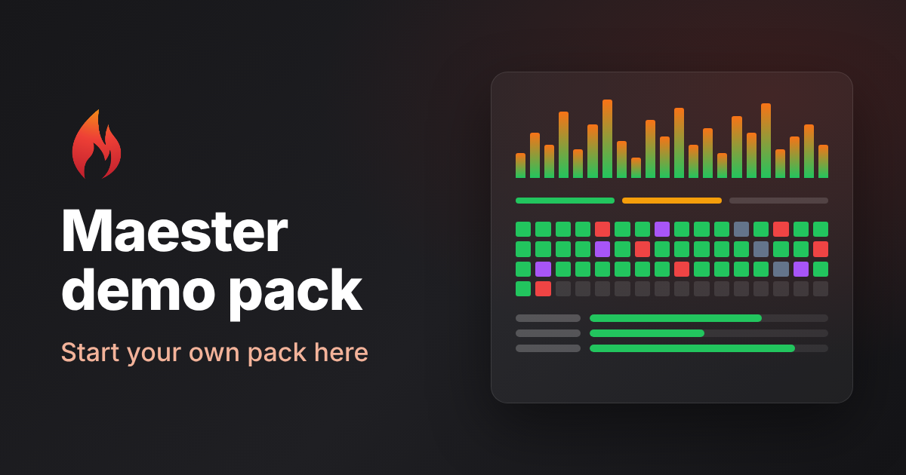

# Maester demo pack

A [Maester Pack](https://maester.dev/docs/next/packs) to try packs out, and the one to copy when you write your own.
Every test uses made-up data and changes nothing. Only MP.DEMO.1007 reads your tenant: the organization's name,
from Microsoft Graph.

## Try it

```powershell
Install-MtPack maester365/maester-pack-demo
Invoke-Maester -Pack DEMO -SkipBuiltIn
```

To confirm the install, type the pack's code, `DEMO`. `-Pack DEMO` runs this pack, including its long-running
test, and `-SkipBuiltIn` leaves out Maester's own tests. Run it in a console that is large enough for
the full-screen dashboard to see the live progress of MP.DEMO.1008. To run the pack's connector test
(MP.DEMO.1006) instead of skipping it, connect its made-up service first:

```powershell
Connect-Maester -Service DEMO.Sample
# or, to see it fail:
Connect-Maester -Service DEMO.Sample -ServiceSetting @{ MfaRequired = $false }
```

| ID | What it shows |
| --- | --- |
| MP.DEMO.1001 | A Passed result |
| MP.DEMO.1002 | A Failed result with a table and a remediation, and a setting (`MinimumScore`) each tenant can change |
| MP.DEMO.1003 | An Investigate result |
| MP.DEMO.1004 | A Skipped result with a reason of its own |
| MP.DEMO.1005 | An Error result from a test that throws |
| MP.DEMO.1006 | The pack's own connector for a made-up service (`DEMO.Sample`), and the skip when it is not connected |
| MP.DEMO.1007 | A Microsoft Graph read, declared in the manifest |
| MP.DEMO.1008 | A long-running test: live output and progress in the dashboard, and its own report of charts in the Maester report |
| MP.DEMO.1009 | A family: one result per object (three made-up apps) |

Change a setting in your `maester-config.json`:

```json
{
  "TestSettings": [
    { "Id": "MP.DEMO.1002", "Parameters": { "MinimumScore": 70 } },
    { "Id": "MP.DEMO.1008", "Parameters": { "ItemMilliseconds": 200 } }
  ]
}
```

## Make your own pack from this one

1. Press **Use this template** on GitHub (or clone this repository) to make a repository of your own, under the
   GitHub user or organisation that will publish the pack.
2. In your copy, run the setup function with your pack's ID, code and name:

   ```powershell
   . ./tools/Initialize-MtPackFromDemo.ps1
   Initialize-MtPackFromDemo -Id contoso.google-workspace -Code CNT -Name 'Contoso Google Workspace checks'
   ```

   It renames the pack, its tests (`MP.CNT.1001` and so on), its service and its functions, gives it a new GUID
   and points the links at your repository.
3. Replace the made-up tests with your own. Keep the ones whose pattern you need (a family, a setting, a
   connector, a long-running test) and delete the rest.
4. Replace `assets/banner.png`, or remove `Banner` from the manifest. See
   [Banner image](https://maester.dev/docs/next/packs/writing-a-pack#banner-image).
5. Check the pack and run its tests from the folder:

   ```powershell
   Test-MtPack .
   Invoke-MtTest -Path .
   ```

6. Delete the `tools` folder and push. Others install it with `Install-MtPack <owner>/<repository>`.
7. Choose how new versions reach people: see [Versions and releases](#versions-and-releases).

To start from an empty pack instead, run `New-MtPack`. The full guide is
[Writing a pack](https://maester.dev/docs/next/packs/writing-a-pack).

## Learn how to write the tests

A pack's tests are Maester native tests, so the guides for writing tests apply to them as they are. Read these
before you write or change a test, whether you write it yourself or ask an AI agent to:

- [Writing native tests](https://maester.dev/docs/next/writing-tests/): the `[MaesterTest]` attribute, the
  `.md` file, what a test returns, `Service` and `License`, parameters, families and settings.
- [Your first custom test](https://maester.dev/docs/next/writing-tests/first-custom-test): a short walk-through.
- [Formatting test results](https://maester.dev/docs/next/writing-tests/formatting-test-results): tables,
  remediation and how a result should read.
- [Attribute rubric](https://maester.dev/docs/next/writing-tests/attribute-rubric): which `Product`, `Feature`,
  `Area`, `Severity`, `UserImpact`, `ImplementationCost` and `Mitre` values to choose.
- [Advanced guide](https://maester.dev/docs/next/writing-tests/advanced-concepts): caching, Graph requests and
  other helpers.
- [Writing a pack](https://maester.dev/docs/next/packs/writing-a-pack): the manifest, connectors, live output
  and progress, report attachments and publishing.
- [Pack security](https://maester.dev/docs/next/packs/security): what Maester checks when someone installs your
  pack, and what makes it fail.
- [Result schema](https://maester.dev/docs/next/result-schema): the fields of each result row.

These links point at the docs for the next Maester version, which has packs.

## What this pack does that yours should too

- **Declare what it reaches.** `Uses` in `maester-pack.json` lists the services, Graph scopes, network hosts and
  modules the pack uses. Install-MtPack shows it to the person installing, and the content checks compare it
  with the code. Keep `TenantWrites` empty unless the pack changes the tenant.
- **Let the engine handle connections and errors.** A test declares `Service`; the engine skips it when that
  service is not connected, and turns an uncaught error into an Error row. No connection checks or
  `try`/`catch` around the whole test.
- **Lead with the finding.** Each result starts with one sentence that says what was found, then the detail as
  a table. Each `.md` says what the test checks and how to fix it, under `#### Remediation action`.
- **Make thresholds settings.** A value a tenant may want to change is a test parameter with a default and a
  `ValidateRange` (MP.DEMO.1002), not a constant.
- **One row per object.** A check of many objects of one kind is a family with an `InstanceSource`
  (MP.DEMO.1009), so each object can be seen, excluded or accepted on its own.
- **Group the results.** `Product`, `Feature`, `Area` and `ResourceType` group the tests in the console and the
  report.
- **Show long work while it runs.** A test that runs for more than a few seconds writes its log with
  `Write-MtTestOutput` and its progress with `Write-MtTestProgress`: stages, items, errors, and its own results
  by group. A tool in another process writes `##maester[progress]` lines instead (MP.DEMO.1008).
- **Add a tool's report to the Maester report, if you want one.** This is optional: a pack does not have to
  include a report, because its results already appear in the Maester report. `Add-MtReportAttachment` puts a
  single-file HTML report under **Reports** in the report's left menu. It runs in a sandboxed frame, so keep it to one file with everything
  inline, and keep values from the tenant out of the markup (`helpers/Get-DemoReportHtml.ps1`). Use it for what
  the results cannot show, such as trends, spread and outliers, not for the results again. The demo's report is
  a gallery of chart ideas; see [Ideas for a pack's report](docs/report-ideas.md).
- **Be easy to trust.** A licence, `Homepage`, `Support` and `SecurityContact` in the manifest, a
  [security policy](SECURITY.md), a [changelog](CHANGELOG.md), and a check on every pull request
  ([.github/workflows/check-pack.yml](.github/workflows/check-pack.yml)).

## Versions and releases

`Install-MtPack <owner>/<repository>` installs the newest GitHub release of a pack. A repository with no release
installs its default branch instead. A copy of this repository has two ways to ship new versions:

- **Track the default branch (the default).** Push to `main` and that is what people install and update to. Nothing
  to set up; raise `Version` in `maester-pack.json` yourself when you want people to see a new number.
- **Publish releases.** Each merged pull request gets the next version and a release, so people install a fixed
  version and see what changed. Once a repository has one release, installs follow releases and ignore `main`.

To publish releases, as an admin of the repository:

1. Turn on the two workflows that do it (they do nothing until this variable is set):

   ```bash
   gh variable set PACK_RELEASES --body true -R <owner>/<repository>
   ```

2. Protect `main`, so every change comes through a pull request that is up to date, has its conversations
   resolved, passes the pack check and is squash-merged (force pushes and deleting `main` are blocked):

   ```bash
   gh api repos/<owner>/<repository>/contents/.github/rulesets/main.json -H "Accept: application/vnd.github.raw" |
     gh api --method POST repos/<owner>/<repository>/rulesets --input -
   ```

   No approval is required, so a maintainer can merge their own pull request; raise
   `required_approving_review_count` in [.github/rulesets/main.json](.github/rulesets/main.json) when the
   repository has more than one maintainer.

3. Optionally create the labels `release:major`, `release:minor`, `release:patch` and `release:none`.

Then every pull request carries the next version. [bump-version.yml](.github/workflows/bump-version.yml) sets
`Version` in `maester-pack.json` one step above the version on `main` and turns `## Unreleased` in
[CHANGELOG.md](CHANGELOG.md) into that version, and pushes that commit to the pull request (pull before you push
to it again). The label picks the part to raise: `release:major`, `release:minor`, `release:patch` (the default,
also when there is no label) or `release:none`; changing the label changes the version. Write what changed under
`## Unreleased` as part of the pull request. A pull request from a fork gets no version commit: its author (or
the maintainer, before merging) raises `Version` and the changelog heading by hand.

Merging publishes the release. [release.yml](.github/workflows/release.yml) runs on each push to `main`, and when
there is no release for the version in `maester-pack.json` yet, it tags the commit `v<Version>` and publishes a
release with that version's changelog section as its notes. A pull request labelled `release:none` keeps the
version, so its merge publishes nothing once that version has a release. To publish the version already on `main`, run the Release workflow by
hand from the Actions tab. `Install-MtPack` offers a new release once it is older than the install cooldown.

This repository tracks its default branch: `PACK_RELEASES` is not set, so the two workflows do nothing here and
`Install-MtPack maester365/maester-pack-demo` installs `main`. `Version` in `maester-pack.json` is raised by hand.

## Files

| Path | What it is |
| --- | --- |
| `maester-pack.json` | The manifest: ID, code, version, the suite, helpers, the connector and what the pack uses |
| `tests/` | The suite: `suite.json`, and one `Test.<ID>.ps1` and `Test.<ID>.md` per test |
| `helpers/` | Functions the tests call: the connector's settings, and the data and HTML of the report |
| `connector/` | `Connect-`, `Test-` and `Disconnect-DemoSample` for the made-up service |
| `assets/banner.png` | The image the pack index shows when it features the pack |
| `assets/insights-report.html` | The page of MP.DEMO.1008's report, with sample data so you can open it in a browser |
| `assets/chart.js/` | Chart.js 4.5.1 and its MIT licence, put inline in the report |
| `docs/report-ideas.md` | An optional guide: what a pack's report can show, and which chart library to use. A pack does not need a report |
| `tools/` | `Initialize-MtPackFromDemo`, which turns a copy into your own pack; delete the folder afterwards. The pack never loads it |
